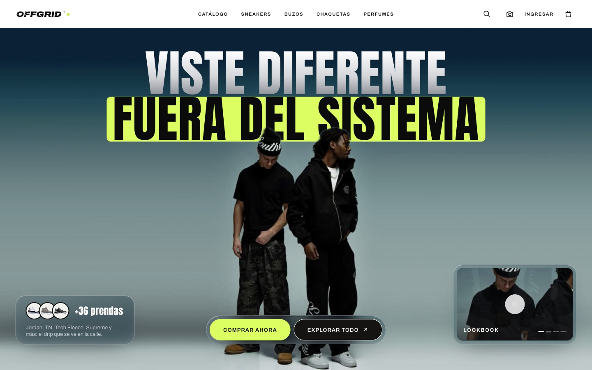
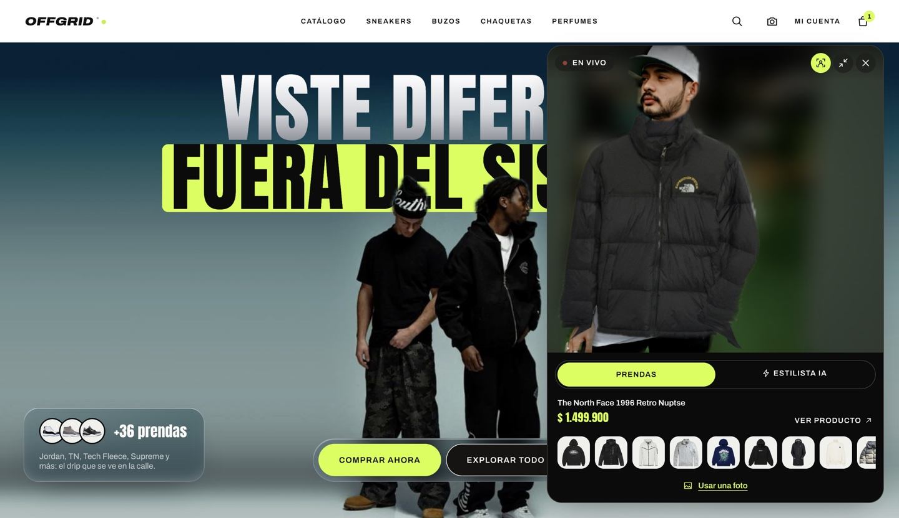
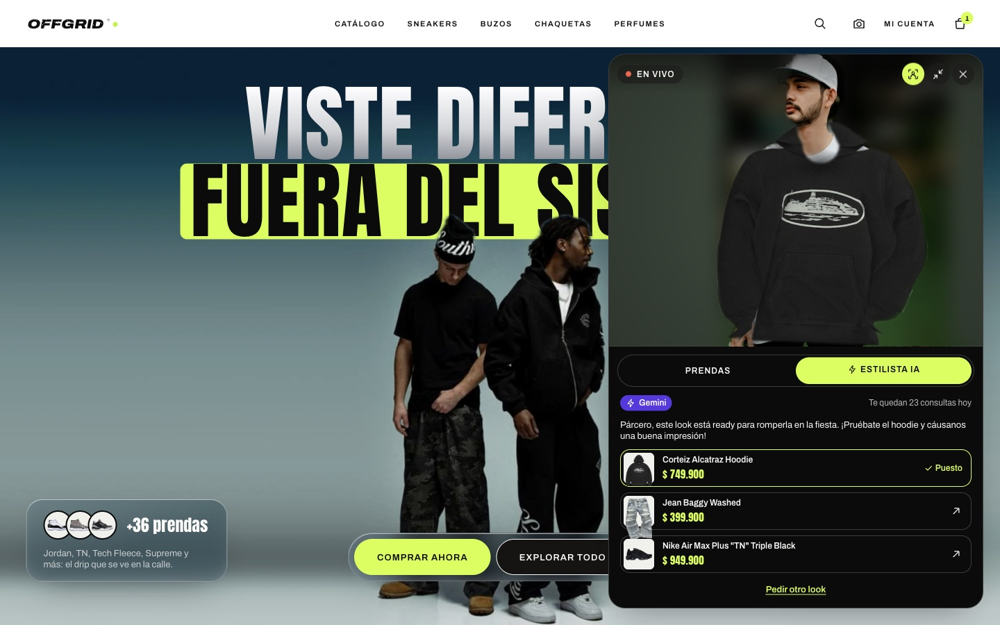
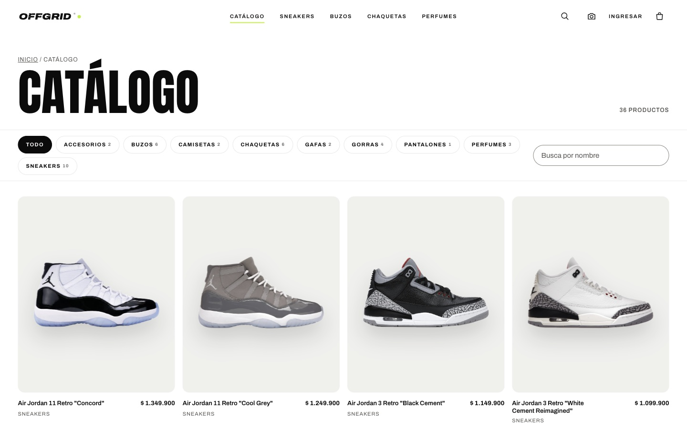
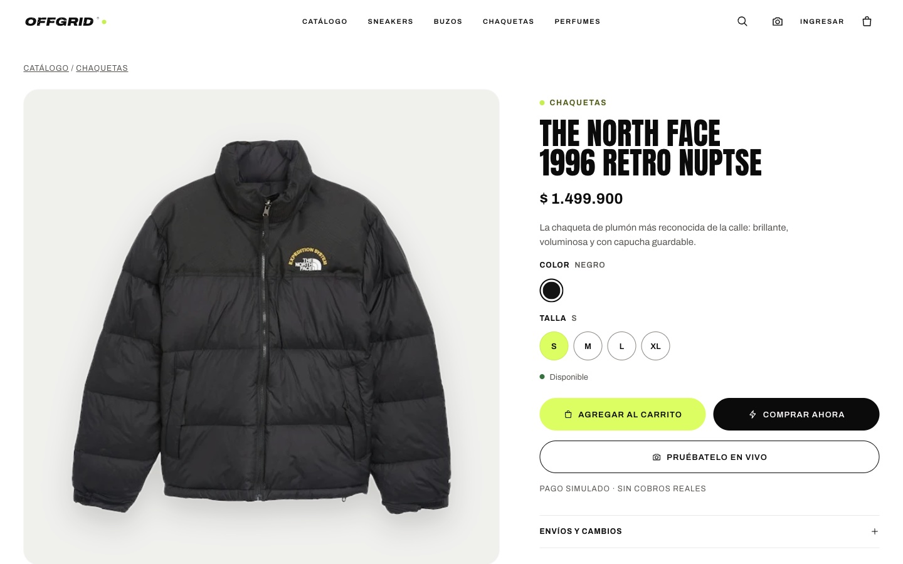
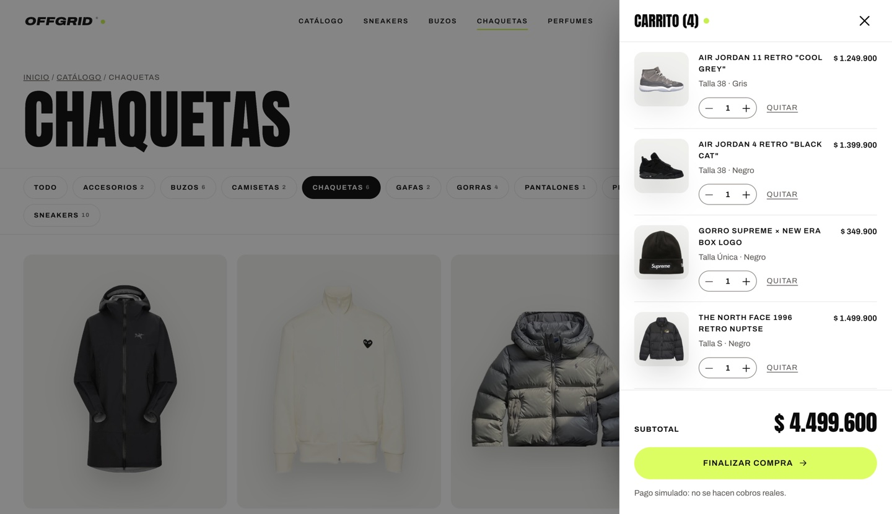
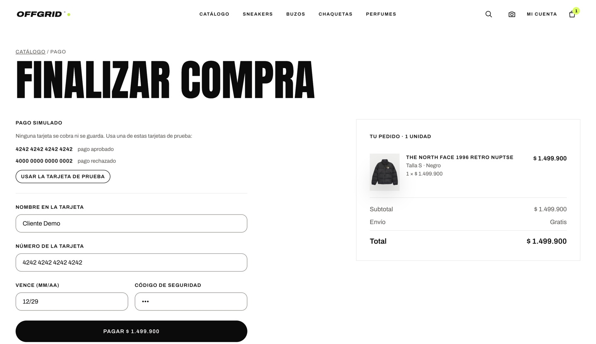
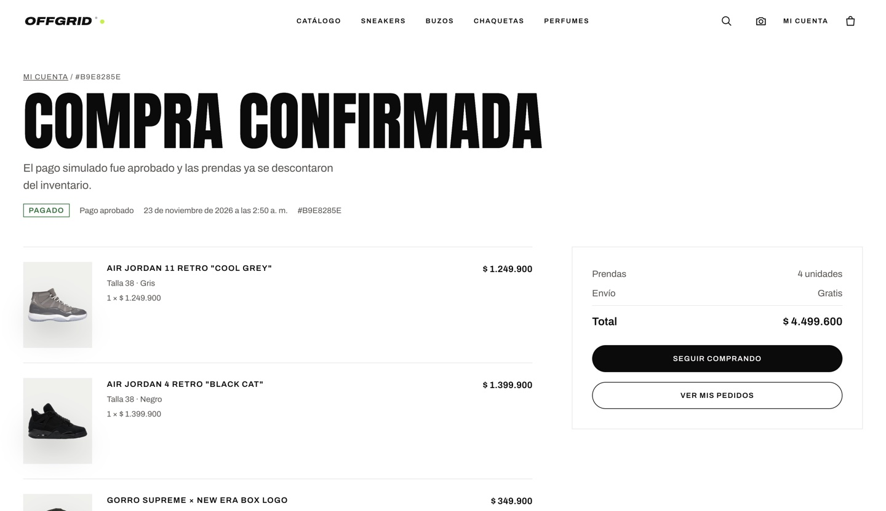
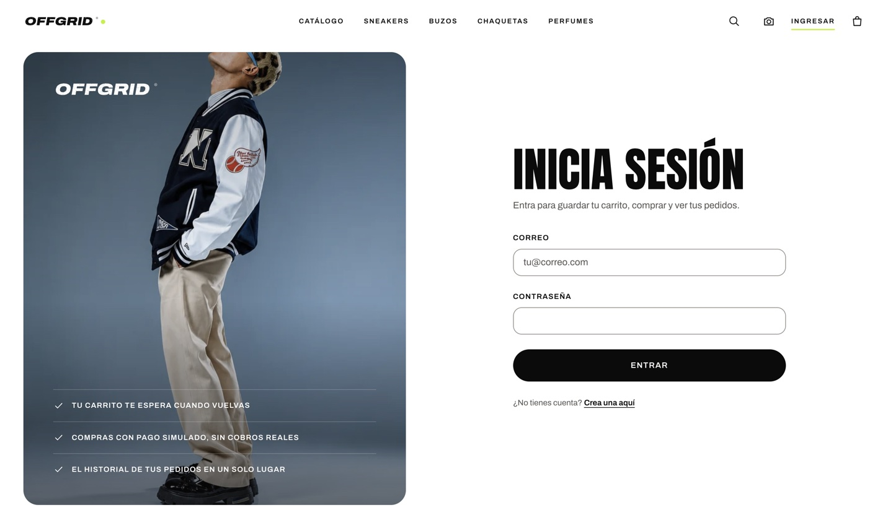
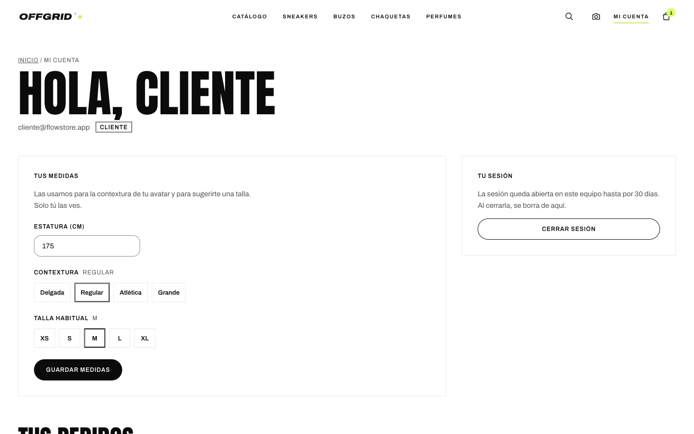

enlace video https://drive.google.com/file/d/1PpiGYMFtb7uo41n8SxkmLDIjviKhF23z/view?usp=sharing

# OFFGRID

**OFFGRID** es una tienda de streetwear de escritorio para Mac. Compras de punta
a punta (catálogo, carrito, pedido, stock y pago simulado) y dos cosas que la
hacen diferente:

- **Probador en vivo:** la cámara funciona como espejo y la prenda del catálogo
  te aparece puesta. Sigue tus hombros y brazos, toma tu silueta, copia la luz
  del cuarto y desenfoca el fondo como el modo retrato de un celular. La visión
  corre en el equipo: la imagen no se guarda ni sale de ahí.
- **Estilista con IA:** le dices la ocasión y el presupuesto y arma un look solo
  con productos reales de la tienda, con precios sacados de la base de datos. La
  prenda que se puede probar se pone sola en el espejo.

El repositorio tiene todas las partes del proyecto:

| Carpeta | Qué contiene |
|---|---|
| [`backend/`](backend/) | API REST en Java 21 + Spring Boot + PostgreSQL. Cuentas, catálogo, stock, carrito, pedidos, pago simulado y estilista con IA. |
| [`desktop/`](desktop/) | App de escritorio con Electron, React y TypeScript: tienda, probador en vivo y estilista. |
| [`docs/`](docs/) | Alcance, arquitectura, decisiones técnicas, guion de la sustentación y capturas. |
| [`scripts/`](scripts/) | Arranque y apagado de la demo con un doble clic. |

## Capturas

Datos de la semilla de prueba, en una ventana de 1440×900.

<table>
  <tr>
    <td align="center"><br>Inicio</td>
    <td align="center"><br>Probador en vivo</td>
  </tr>
  <tr>
    <td align="center"><br>Estilista con IA</td>
    <td align="center"><br>Catálogo</td>
  </tr>
  <tr>
    <td align="center"><br>Producto</td>
    <td align="center"><br>Carrito</td>
  </tr>
  <tr>
    <td align="center"><br>Pago simulado</td>
    <td align="center"><br>Pedido confirmado</td>
  </tr>
  <tr>
    <td align="center"><br>Ingresar</td>
    <td align="center"><br>Mi cuenta</td>
  </tr>
</table>

## Tecnologías

**Backend**

| Pieza | Versión | Para qué |
|---|---|---|
| Java | 21 (LTS) | Lenguaje |
| Spring Boot | 3.5 | Web, seguridad, validación e inyección de dependencias |
| Spring Security + jjwt | 6.5 / 0.13 | Autenticación con JWT y roles |
| Spring Data JPA (Hibernate) | 3.5 | Acceso a datos, con `ddl-auto=validate` |
| PostgreSQL | 18 local o Supabase | Base de datos |
| Flyway | 11 | Migraciones versionadas del esquema |
| springdoc-openapi | 2.9 | Documentación navegable en `/docs` |
| Google Gemini (API compatible con OpenAI) | `gemini-3.5-flash-lite` | Estilista con IA, plan gratuito |

**Escritorio**

| Pieza | Para qué |
|---|---|
| Electron 44 | App de escritorio con cámara, ventana propia e instalador |
| React 19 + TypeScript | Interfaz |
| Vite | Compilación y servidor de desarrollo |
| Motion | Animaciones (respetan «reducir movimiento») |
| MediaPipe Pose Landmarker | Visión por computador en el equipo: 33 puntos del cuerpo y silueta |
| WebGL2 | Dibujo de la prenda en la GPU: malla que se dobla, luz, volumen y sombras |
| electron-builder | Empaquetado como `OFFGRID.app` y `.dmg` |

## Estructura

```
OFFGRID/
├── backend/        API REST (Spring Boot)          → backend/README.md
│   ├── src/main/java/com/flowstore/backend/  un paquete por concepto
│   ├── src/main/resources/db/                migraciones y semilla de prueba
│   └── .env.example                          plantilla de configuración
├── desktop/        app de escritorio (Electron)    → desktop/README.md
│   ├── electron/                             proceso principal y permisos
│   ├── src/mirror/                           probador en vivo y estilista
│   ├── src/pages/, src/components/           pantallas de la tienda
│   └── DESIGN.md                             sistema de diseño
├── docs/
│   ├── 00-alcance.md
│   ├── 01-decisiones.md
│   ├── 02-referencias-diseno.md
│   ├── 03-sustentacion.md
│   ├── arquitectura.md
│   └── capturas/
├── scripts/        start-demo.command, stop-demo.command
└── README.md
```

## Cómo ejecutarlo

### Requisitos

- **macOS con Apple Silicon** para la app de escritorio.
- **JDK 21 o superior.** No hace falta instalar Maven: el proyecto trae el *wrapper*.
- **PostgreSQL 18** (`brew install postgresql@18`) o una base en Supabase.
- **Node 24** para compilar la app.

### 1. Crear la base de datos

```bash
brew services start postgresql@18
createdb flowstore
```

Las tablas y los datos de prueba los crea Flyway al arrancar el backend.

### 2. Configurar el backend

```bash
cd backend
cp .env.example .env
```

Edita `backend/.env` con una clave de firma propia:

```bash
openssl rand -base64 48   # pega el resultado en JWT_SECRET
```

Para el estilista, saca una clave gratuita de Gemini en Google AI Studio y
pégala en `AI_API_KEY` con `AI_ENABLED=true`. Sin clave, el estilista responde
con un plan B por reglas y todo lo demás funciona igual.

### 3. Levantar el backend con datos de prueba

Desde `backend/`:

```bash
SPRING_PROFILES_ACTIVE=dev DB_URL=jdbc:postgresql://localhost:5432/flowstore DB_USERNAME=$USER DB_PASSWORD= ./mvnw spring-boot:run
```

La API responde en `http://localhost:8080` y su documentación en
**http://localhost:8080/docs**.

### 4. Abrir la app

```bash
cd desktop
npm install
npm run dev            # desarrollo, con recarga automática
npm run package:dir    # app empaquetada en desktop/release/mac-arm64/OFFGRID.app
```

**Atajo para la demo:** con la base creada y la app empaquetada, doble clic en
`scripts/start-demo.command`. Enciende PostgreSQL, arranca el backend y abre la
app. `scripts/stop-demo.command` los apaga.

### 5. Ingresar

**Usuario de prueba:** `cliente@flowstore.app` / `Cliente123!`

Atajos de teclado: `M` abre el probador, `F` desenfoca el fondo, `C` abre el
carrito y `/` busca.

## API

Base: `http://localhost:8080/api/v1`. El catálogo es público; el resto exige
`Authorization: Bearer <token>`. La referencia completa, con ejemplos, está en
**http://localhost:8080/docs** y en [backend/README.md](backend/README.md).

| Grupo | Endpoints |
|---|---|
| Autenticación | `POST /auth/register`, `/auth/login`, `/auth/refresh`, `/auth/logout`, `/auth/forgot-password`, `/auth/reset-password` |
| Perfil | `GET` y `PUT /me` |
| Catálogo | `GET /products`, `GET /products/{id}`, `GET /categories` |
| Administración (`ADMIN`) | `POST` y `PUT /products`, `POST /products/{id}/variants`, `POST /products/{id}/variants/{variantId}/restock`, `POST` y `PUT /categories` |
| Carrito | `GET /cart`, `POST /cart/items`, `PUT` y `DELETE /cart/items/{variantId}` |
| Pedidos y pago simulado | `POST /orders`, `GET /orders`, `GET /orders/{id}` |
| Estilista con IA | `POST /stylist/outfits`, `GET /stylist/status` |

## Decisiones de diseño

**1. Una sola fuente de verdad.** El stock es la suma de `stock_movements` (cada
entrada o venta es un movimiento) y el total del pedido se calcula desde sus
líneas. No hay cifras duplicadas que se puedan desincronizar.

**2. Dinero sin coma flotante.** `BigDecimal` y `NUMERIC(14,2)`. Cada línea del
pedido guarda el precio del momento de la compra.

**3. Aislamiento por usuario.** El `userId` sale siempre del token, nunca de un
parámetro. Un pedido ajeno devuelve 404 y no 403, para no confirmar que existe.

**4. La clave de la IA vive solo en el servidor.** La app le habla al backend y
el backend habla con Gemini.

**5. La IA no inventa productos.** Busca en la base de datos con una herramienta
y responde con ids. El servidor revalida cada producto (activo y con stock) y
pone los precios. Si la IA falla o no hay internet, responde un plan B por
reglas.

**6. El probador corre en el equipo.** MediaPipe da los puntos del cuerpo y la
silueta; la foto del producto se vuelve una malla con cinco huesos (torso, brazos
y antebrazos) que se dobla con la persona, y un *shader* le pone luz, volumen y
sombras. Sin servidores de pago ni envío de imágenes.

**7. Sesión segura.** Contraseñas con BCrypt (costo 10). Token de acceso de 15
minutos en memoria y de refresco de 30 días, revocable y guardado como SHA-256.

Más detalle en [docs/arquitectura.md](docs/arquitectura.md) y el porqué de cada
decisión en [docs/01-decisiones.md](docs/01-decisiones.md).

## Pruebas

```bash
cd backend
./mvnw test
```

59 pruebas con JUnit, Mockito y Spring Test: registro e inicio de sesión,
permisos por rol, cálculo de pedido y stock, que un usuario no vea datos de otro,
el estilista con IA y el pago simulado. No necesitan base de datos ni red. El
esquema se valida al arrancar: con `ddl-auto=validate`, el servidor no arranca
si las tablas y las entidades difieren.

## Pendientes

1. **Simular la tela en 3D** en el probador, en lugar de deformar la foto del producto.
2. **Prendas de abajo** (pantalones) en el probador.
3. **Pasarela de pago real** en lugar del pago simulado.
4. **App firmada** para distribuir en Mac y Windows.

## Autor

**brash777** · [github.com/brash777](https://github.com/brash777)
