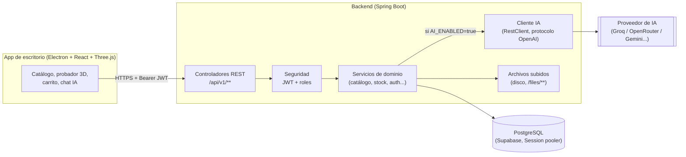

# FlowStore · Decisiones (Fase 1)

> 12 de octubre de 2026. Estas decisiones las tomé yo (Claude) siguiendo el criterio
> "prioriza que funcione y se vea bien en la demo", como se me pidió. Quedan escritas
> para que se puedan defender ante el profesor.

## 1. Enfoque del avatar 3D

### Las opciones que se compararon

| Enfoque | Cómo funciona | Costo | Calidad esperada | Riesgo para este caso |
|---|---|---|---|---|
| **A. Servicio externo de foto→avatar** (p. ej. Ready Player Me, Avaturn) | Se manda la foto a una API que devuelve un avatar 3D completo y rigeado. | Gratis en capa básica, pero con límites de uso y marca de agua o estilo fijo en el plan gratuito. | Alta en parecido facial. | **Alto.** El rig (el esqueleto del modelo) y la malla del cuerpo son del proveedor, no nuestros. Para equipar NUESTRA ropa (hecha en Blender para nuestro propio cuerpo base) sobre un avatar ajeno, la malla de cada prenda tendría que calzar exactamente con un cuerpo que no controlamos. Es el mismo problema que poner una camisa de una tienda sobre un maniquí de otra: puede quedar flotando o deformada. Además depende de que el servicio esté en línea el día de la sustentación. |
| **B. Avatar paramétrico con cuerpo base propio** | Un cuerpo base se modela una sola vez en Blender (con variantes de contextura). La foto se analiza para elegir tono de piel, color y estilo de cabello, y accesorios simples (lentes, barba). El resultado es ese cuerpo, vestido con esos rasgos. | $0. Todo corre en el propio backend con una librería de procesamiento de imagen (nada de IA de pago). | Media: se parece en tono de piel, pelo y contextura, no en la cara. | **Bajo.** El cuerpo es nuestro, así que cada prenda que se modele en Blender para ese cuerpo SIEMPRE calza. No depende de ningún servicio externo: si no hay internet, el avatar se sigue generando. |
| **C. 2D por capas** (como un papel muñeca: capas de imagen que se apilan) | La "ropa" son recortes PNG que se superponen sobre una ilustración del cuerpo. | $0. | Baja como "3D real", pero vistosa si el arte es bueno. | **Bajo técnicamente, alto para la nota:** no es un avatar 3D, que es justo lo que hace diferente al proyecto. Sirve como red de seguridad, no como producto principal. |

### Decisión: Opción B, con C como respaldo de demo

Se construye el **avatar paramétrico**: un cuerpo base (o 2-3 variantes de contextura) modelado una sola vez en Blender, al que la app le aplica, según la foto, el tono de piel (se promedia el color de piel en la zona de la cara), el color de cabello (idem en la zona del pelo) y una categoría de estilo de peinado elegida entre unas pocas opciones (el usuario puede corregirla a mano). Esa configuración se guarda como JSON (columna `avatars.config`) y es lo que el visor 3D en Three.js usa para pintar el modelo.

**Qué SÍ se le promete al profesor:**
- Un avatar 3D real, que el usuario puede rotar y hacer zoom, con el tono de piel y el color/estilo de cabello tomados de su foto.
- Cada prenda del catálogo se equipa sobre ese avatar sin fallar, porque está modelada para ese cuerpo exacto.
- La foto se puede borrar después de generar el avatar; se avisa al usuario antes de subirla.

**Qué NO se le promete:**
- Que el avatar sea un escaneo 3D de la cara del usuario. Eso (fotogrametría o reconstrucción facial) necesita o un servicio de pago con buena capa gratuita limitada, o GPU propia potente; no entra en el presupuesto ni en el tiempo de este proyecto. Se explica así si preguntan: "no reconstruimos tu cara en 3D, construimos un avatar que se viste con tu estilo: tono de piel, pelo, contextura".

**Respaldo para que la demo no falle:** si el análisis de una foto en particular sale raro (mala luz, foto de medio cuerpo, etc.), hay un **editor manual** donde el usuario elige a mano el tono de piel, el cabello y la contextura con controles simples (sliders/swatches), sin pasar por la foto. Antes de la sustentación se prueba con 2-3 fotos conocidas para no improvisar en vivo.

## 2. Funciones de IA elegidas

De las 8 que se propusieron, se eligieron 4 para un solo "agente" de IA (mismo motor, 3 formas de usarlo) más 2 versiones sin IA como respaldo:

| # | Función | Veredicto | Por qué |
|---|---|---|---|
| 1 | Estilista virtual (chat) | **Se construye** | Es la de mayor impacto en la demo: hablarle a una IA y que vista al avatar. |
| 2 | Outfit por ocasión y presupuesto | **Se construye** | Mismo motor que el 1, reutiliza las mismas herramientas (tools) sobre la base de datos. |
| 6 | Búsqueda en lenguaje natural | **Se construye**, como una herramienta más del mismo agente | No hace falta un sistema aparte: es otra "tool" que el modelo puede invocar (`buscar_productos`). |
| 3 | Completar el look | **Se construye, pero SIN IA** | Se resuelve con una regla simple sobre el catálogo (misma categoría complementaria, no repetir ranura). Es gratis, instantáneo y nunca se cae. |
| 5 | Talla sugerida | **Se construye, SIN IA** | Reglas sobre estatura/contextura guardadas en el perfil. No necesita modelo de lenguaje. |
| 4 | Análisis de foto para el avatar | **Se construye, SIN IA de terceros** | Se resuelve con procesamiento de imagen (promedio de color), no con una IA generativa. Ver sección 1. |
| 7 | Descripción/etiquetas de producto (admin) | **Si alcanza el tiempo (P1/P2)** | Bonito para el admin, pero no es crítico para la experiencia del cliente. |
| 8 | Resumen de reseñas | **Fuera de alcance** | No hay reseñas reales en el MVP (ver `00-alcance.md`). |

**Cómo funciona el agente de IA (1+2+6):** un único endpoint de chat recibe el mensaje del usuario y, usando *tool calling* (la IA pide ejecutar funciones del lado del servidor, nunca inventa datos), puede llamar a `buscar_productos(categoria, slot, texto, precioMax)` y `armar_outfit(ocasion, presupuesto)`, ambas consultando la base de datos real. **La IA nunca inventa productos ni precios**: solo puede mostrar lo que esas herramientas le devuelven.

**Proveedor:** un cliente HTTP genérico, compatible con el protocolo de OpenAI (chat completions + tool calling), configurable por variables de entorno (`AI_BASE_URL`, `AI_API_KEY`, `AI_MODEL`). Por defecto apunta a Groq (capa gratuita generosa, modelos Llama con soporte de *tool calling*), pero cambiar de proveedor es cambiar esas tres variables, sin tocar código — útil porque dijiste que ya tienes otra API distinta a la de Anthropic.

**Reglas aplicadas:** `AI_ENABLED` apaga la IA sin romper nada (los endpoints responden 503 con mensaje claro); límite diario de mensajes por usuario (`daily-message-limit`, por defecto 40) para no agotar la cuota gratuita; la clave vive solo en el backend.

## 3. Tecnología de escritorio

| | Electron + Three.js | Tauri + Three.js |
|---|---|---|
| Render 3D | Three.js corre igual en el navegador embebido de Electron (Chromium). | Three.js corre en el WebView del sistema (WKWebView en Mac, WebView2 en Windows): mismo código, pero el motor de render del navegador varía según el sistema operativo, lo que es un riesgo extra si la demo se corre en una máquina distinta. |
| Lenguaje del lado "nativo" | JavaScript/Node en el proceso principal: mismo lenguaje que el renderer. | Rust. Para subir una foto, guardar un token o hablar con el backend hay que escribir o aprender Rust. |
| Tiempo para aprender | Si ya se sabe JavaScript, se empieza de una. | Curva de aprendizaje de Rust, que no estaba contemplada. |
| Tamaño del instalador | Más pesado (incluye Chromium completo, ~150 MB). | Más liviano (~10-20 MB). |
| Qué tan importante es eso aquí | El tamaño del instalador no se evalúa en la sustentación. | — |

### Decisión: Electron + React + Three.js (con `@react-three/fiber`)

Un solo lenguaje (JavaScript/TypeScript) para toda la app de escritorio, ejemplos abundantes de Three.js dentro de Electron, y cero tiempo perdido aprendiendo Rust esta semana. El tamaño del instalador es la única desventaja real, y no es un criterio de la sustentación.

## 4. Dónde se guardan los archivos subidos

**Disco local** (carpeta `backend/uploads/`, servida bajo `/files/**`), no Supabase Storage.

**Por qué:** para la demo, cada servicio externo adicional es un punto más donde algo puede fallar el día de la sustentación (login de Storage, política de bucket, CORS). Guardar en disco es cero configuración adicional y cero dependencia de internet para ver las fotos.

**Cómo se valida cada archivo** (`FileStorageService`, `FileCategory`, `FileType`):
- Tamaño máximo por tipo: 5 MB para fotos y 20 MB para modelos 3D.
- La extensión tiene que ser una permitida: jpg, jpeg, png o webp para fotos, y glb para modelos 3D.
- Los primeros bytes del archivo (su "firma") tienen que corresponder a esa extensión. Un `.exe` renombrado a `.jpg` se rechaza. No se confía en el `Content-Type` que manda el cliente, porque se puede falsificar.
- El nombre lo genera el servidor (un UUID). El nombre original nunca llega al disco.
- Solo se publican bajo `/files/**` las carpetas públicas (fotos de producto y modelos 3D). **Las fotos de avatar nunca se sirven por URL**, porque son datos sensibles.

**Limitación que hay que poder explicar:** si el backend se despliega en un servidor sin disco persistente (p. ej. una plataforma gratuita que reinicia el sistema de archivos), los archivos subidos se perderían. Para este proyecto no aplica porque corre en la máquina del estudiante. Mejora futura anotada en `00-alcance.md`: migrar a Supabase Storage para una puesta en producción real.

## 5. Arquitectura



La app de escritorio nunca habla directo con la base de datos ni con el proveedor de IA: todo pasa por el backend, que es el único que tiene las credenciales.

## 6. Modelo de datos

Ya implementado en `backend/src/main/resources/db/migration/V1__initial_schema.sql` (22 tablas). Resumen de las decisiones que vale la pena poder explicar:

- **Sin totales guardados aparte.** `orders` no tiene columna de total; se calcula siempre sumando `order_items`. El stock de una variante nunca es una columna: es `SUM(stock_movements.quantity_delta)`. Así es imposible que un total o un stock quede "desincronizado" de su fuente.
- **Snapshot en las líneas de pedido.** `order_items` guarda el nombre y el precio de la prenda en el momento exacto de la compra. Si el producto cambia de precio después, el historial de pedidos no se altera.
- **Un modelo 3D por producto, no por variante.** La tabla `assets_3d` tiene una fila por producto (`UNIQUE(product_id)`); el color de cada variante se aplica como un tinte sobre ese mismo modelo en el visor, no como un archivo distinto. Evita modelar la misma camisa 5 veces solo porque viene en 5 colores.
- **El rol vive en el usuario, no hay tabla de permisos aparte.** Con dos roles (`CUSTOMER`, `ADMIN`) alcanza; una tabla de permisos sería sobre-ingeniería para este alcance.
- **La tabla de reseñas existe desde ya** aunque su función (resumen con IA) es P2, para no necesitar otra migración el día que se construya.
- **`payments` no guarda el monto.** Sería una copia del total del pedido, y la regla del proyecto prohíbe totales duplicados. El monto pagado se calcula desde `order_items`.

## 7. Decisiones en el código (para la sustentación)

El código no lleva comentarios. Lo que antes explicaban los comentarios queda aquí.

**Seguridad y sesiones**
- **Contraseñas con BCrypt de costo 10.** Es un hash lento a propósito: aunque se filtre la base de datos, probar contraseñas por fuerza bruta no es viable.
- **Login sin filtrar quién tiene cuenta.** Si el correo no existe, igual se compara la contraseña contra un hash falso del mismo costo, y el mensaje de error es el mismo en los dos casos. Así ni el tiempo de respuesta ni el texto revelan si un correo está registrado.
- **El JWT va firmado pero no cifrado.** Cualquiera puede leer su contenido (id, correo, nombre, rol), pero nadie puede modificarlo, por ejemplo cambiar CUSTOMER por ADMIN, sin invalidar la firma. Por eso no lleva nada más sensible. Un token sin rol o con un rol desconocido se rechaza.
- **Refresh tokens con rotación.** Cada refresh revoca el token usado y entrega uno nuevo. Si alguien reutiliza un token viejo, ya no sirve.
- **En la base solo se guarda el SHA-256 de los tokens.** Si alguien lee la tabla, no obtiene credenciales que pueda usar. Aquí sí sirve un hash rápido, porque los tokens son 32 bytes aleatorios y no hay diccionario con el que adivinarlos.
- **El registro público siempre crea un CUSTOMER.** No existe endpoint para crear un ADMIN. Si el registro aceptara un rol, cualquiera podría crearse una cuenta de administrador.
- **Restablecer la contraseña cierra todas las sesiones del usuario.** El token de recuperación solo aparece en el log en perfil `dev` (nivel DEBUG), nunca en producción.
- **Recurso de otro usuario → 404, no 403.** El `userId` sale siempre del token. Responder 403 confirmaría que el recurso existe.

**Datos**
- **Stock sin carreras.** Para vender, primero se bloquea la fila de la variante (`SELECT ... FOR UPDATE`) y después se suma el stock. Dos compras simultáneas de la misma prenda quedan en fila, así que el stock nunca queda negativo.
- **Paginación con orden fijo** (por nombre). Sin orden, la misma página puede devolver productos distintos en cada consulta.
- **Sin consultas N+1.** El listado del catálogo trae las categorías, las miniaturas, el stock y los colores de toda la página en 4 consultas, no 3 por producto. Los colores van en el listado porque la grilla los necesita para pintar cada prenda y mostrar las muestras de color.

**Errores**
- **Un solo formato de error** (`ApiErrorResponse`): `code` estable para el programa y `message` en español para la persona.
- **Los mensajes viven en `messages.properties`**, no en el código. El código queda en inglés y la app responde en español. Agregar otro idioma sería agregar un archivo.
- **Peticiones mal formadas responden 400, no 500**: JSON roto, UUID inválido, parámetro faltante o ruta inexistente. Un error inesperado responde un texto genérico y el detalle va solo al log del servidor.

**App de escritorio**
- **Una sola fuente de verdad también en la interfaz.** Precios, stock, tallas y colores siempre salen del backend. La app no guarda copias propias del catálogo.
- **Las prendas se dibujan, no son fotos.** Cada prenda es un SVG por capas (silueta, textura de tela, luz de estudio, sombras, costuras y herrajes) que se pinta con el `colorHex` real de la variante. Así, al cambiar de color en la página de producto, la prenda cambia de verdad y no hay que tener una foto por color. El tipo de dibujo se elige por la categoría y el nombre del producto (`src/lib/garments.ts`). Cuando existan los renders de Blender, se usan las imágenes del producto.
- **Rutas con `#`** (`#/catalog`, `#/product/<id>`). Funcionan igual en desarrollo y en la app empaquetada (que abre un archivo local), y los botones de atrás y adelante sirven sin configurar nada.
- **El carrito vive en memoria por ahora.** Se conecta al backend en la fase 6, que es cuando el total se calcula en el servidor desde las líneas del pedido. El botón de pagar queda deshabilitado y lo dice.
- **Errores de red con mensaje claro.** Si el backend está apagado, cada sección muestra "Sin conexión con la tienda" con un botón para reintentar; nada se queda en blanco.
- **Movimiento solo con `transform` y `opacity`.** Ninguna animación cambia tamaños ni posiciones del layout, y todas se apagan con "reducir movimiento" del sistema. El carrusel del inicio se pausa con el mouse y tiene botón de pausa.

## 8. Pendiente para seguir

Para que el backend llegue a correr contra una base de datos real falta que me compartas (en el chat o directo en tu `.env`, nunca en un commit):

```
DB_URL=jdbc:postgresql://aws-0-<region>.pooler.supabase.com:5432/postgres?sslmode=require
DB_USERNAME=postgres.<project-ref>
DB_PASSWORD=<tu password de Supabase>
```

Eso sale de Supabase: Project Settings → Database → Connection string → **Session pooler** (no "Direct connection", que es solo IPv6; no "Transaction pooler" / puerto 6543, que rompe las migraciones de Flyway).
